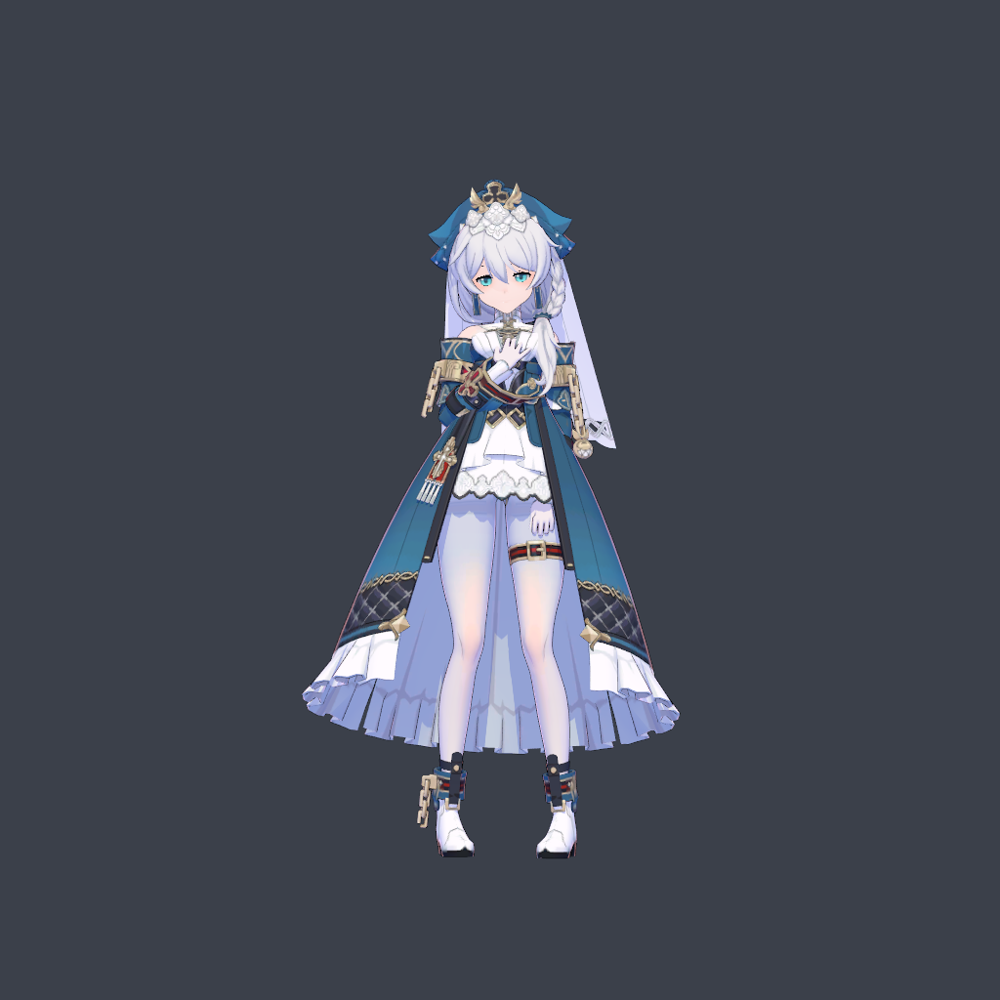
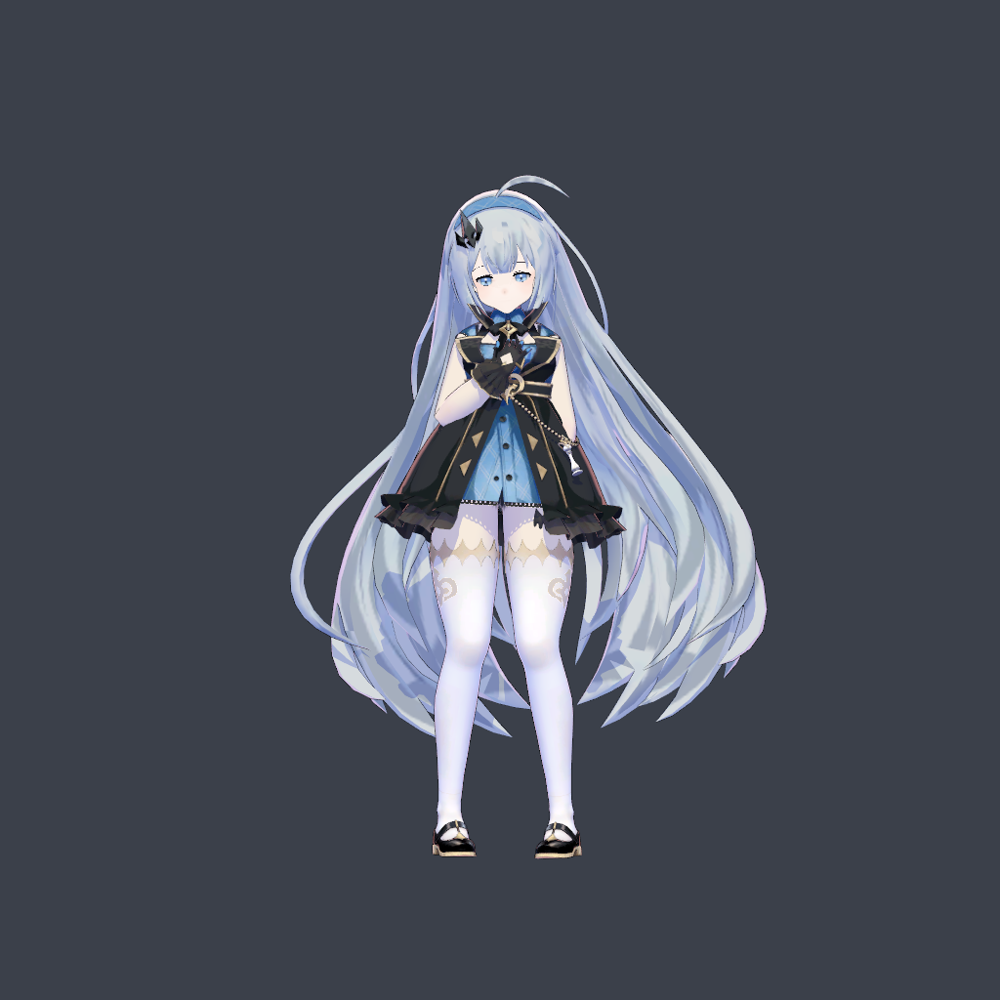
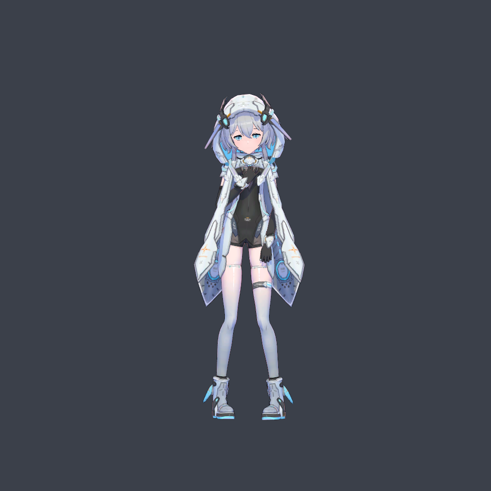

# pmx2KK

**v0.2.1 · Blender 4.5.0 → 原版 Koikatsu 原生人物部件与人物卡**

将已有 PMX 的身体、服装、头发适配到 KK 骨架，并用源模型的脸型、肤色和瞳孔拟合原生头部。保留 KK 面部拓扑、UV 和 81 个原生表情通道，可在游戏中使用表情、捏脸和整套换装。转换在本机完成，不需要 MCP、AI agent、在线生成服务或额外的 pmx2KK 游戏运行时插件。

这是需要人工检查分类与效果的转换工具。面部是近似拟合；服装目前合并为一个上衣部件；长发、裙摆物理需要单独适配。请先读限制，再转换自己的模型。

## 实际效果

下图来自 v0.2.1 验收时的 **KK Studio 实际运行截图**，保留源角色穿着。完整正、侧、背面及表情特写见[图文复现](examples/README.md#实际效果与验收截图)。

| 德丽莎 | 女魔王 | 利维坦 |
|---|---|---|
|  |  |  |

模型署名：德丽莎—神帝宇 / miHoYo；女魔王—星塔旅人/魔王酱酱酱_ / 悠星网络；利维坦—神帝宇 / 深空之眼。截图仅作效果展示，模型来源与规约见文末。

## 下载与文档

- [v0.2.1 发布页](https://github.com/ZhiyeLi/pmx2kk/releases/tag/v0.2.1)：安装 `pmx2KK-0.2.1.zip`，不要把 GitHub 自动生成的 Source code ZIP 当作插件安装包。
- [环境搭建](docs/SETUP.md)：依赖版本、Blender 安装、五项路径、Studio 模板获取。
- [完整使用教程](docs/USER_GUIDE.md)：从 PMX 到游戏人物卡，参数解释与验收。
- [三个示例的图文复现教程](examples/README.md)：德丽莎、女魔王、利维坦的配置与实际效果截图。
- [故障排查](docs/TROUBLESHOOTING.md)、[结构与开发](docs/ARCHITECTURE.md)、[验证范围](docs/VALIDATION.md)。

Release 新增图文版 `pmx2KK-0.2.1-examples-and-docs-illustrated.zip` 和 `SHA256SUMS-illustrated.txt`，包含实际效果截图、完整教程与配置；原版纯文档包与校验文件仍保留。模型、贴图、转换后人物卡、zipmod、游戏文件和第三方工具均不在下载包内。

## 快速开始

1. 准备 Windows、Blender **4.5.0**、原版 KK，以及[依赖和本地材质模板](docs/SETUP.md)。当前不支持 Sunshine。
2. Blender → 编辑 → 偏好设置 → 插件 → 从磁盘安装，选择安装包并启用 pmx2KK。
3. 填好 KK、SB3Utility、mmd_tools、Studio 材质模板路径；要生成完整彩色瞳孔卡，再提供本地女性基础卡并安装 KK OverlayMods。
4. 3D 视图按 `N` → pmx2KK。选 PMX 和独立工作目录 → **检查 PMX** → **载入源模型**。
5. 检查部件分类与骨骼映射；可按[示例说明](examples/README.md)应用匹配版本的 preset。勾选确认。
6. **转换并渲染** → **载入转换预览**，检查正、侧、背面，再 **生成 zipmod**。
7. 将任务目录 `output/` 内的 `*-native.zipmod` 放入 `KK/mods/`，`*-native.png` 放入 `KK/UserData/chara/female/`。重启 KK，载入卡并完成游戏内验收。

## v0.2.1 修复

眼周、嘴周皮肤改为源 UV 采样与连续补色；限制和平滑面部位移，统一 UV 接缝重合点，修正法线与腮部鼓起。皮肤通过未压缩 DDS mip 链导入 Unity ARGB32，避免 DXT5 在浅色渐变上形成色环。已验收的归一化、身体适配和瞳孔保持不变。详见[发布说明](docs/RELEASE-v0.2.1.md)。

## 支持边界

| 项目 | v0.2.1 行为 |
|---|---|
| 人物 | 标准 MMD 人形骨架 → 原版 KK 女性骨架 |
| 身体 / 衣服 | 原贴图与 UV；身体、鞋、手套等合并到整套上衣，可整体替换 |
| 头部 | KK 原生拓扑 / UV / 表情；PMX 脸型近似拟合、皮肤颜色转移 |
| 瞳孔 | 原色左右虹膜；完整颜色随卡内 KSOX 数据保存，需卡与 zipmod 配套 |
| 头发 | 默认固定在头部；可选短刘海模板物理；不自动转换 PMX 刚体链 |
| 捏脸 | 可用，但大幅调整后需重新检查头发、饰品与颈部贴合 |
| 不支持 | 男性 / 非人形 / 任意自定义骨架 / Sunshine / 任意模型无人值守转换 |

## 源码许可

自主代码、文档和示例配置按 [pmx2KK Noncommercial Source License](LICENSE) 提供：允许非商业使用、修改和按相同条款分享，商业使用需另获书面许可。这是源码可见的非商业项目，不宣称为 OSI 开源软件。第三方组件使用各自许可，见 [THIRD_PARTY_NOTICES.md](THIRD_PARTY_NOTICES.md)。

## 模型来源与使用规约

三个示例提供转换配置、源文件 SHA256、复现说明及实际效果截图。请从作者渠道自行获取模型、保留完整贴图目录和随附规约。**禁止将原 PMX、贴图、转换后的卡或 zipmod 随本仓库再次发布。** 转换工具的许可不代替模型作者授权；非商业也不自动等于允许二次分发。

| 示例 | 作者 / 权利归属 | 来源入口 |
|---|---|---|
| 协同者德丽莎·阿波卡利斯 | 模型编辑：神帝宇；版权：miHoYo | [作者模型页](https://www.aplaybox.com/details/model/vanHVdtz5qq6) |
| 女魔王（游戏比例版） | 模型：星塔旅人 / 魔王酱酱酱_；版权：悠星网络 | [作者配布公告](https://www.bilibili.com/video/BV1TuQmBVEon/)；依公告获取，不是直链 |
| 深空之眼—利维坦 | 模型编辑：神帝宇；版权：深空之眼 | [作者作品页](https://www.aplaybox.com/u/359396473/model)；搜索「利维坦」。尚未确认该版本的独立原始配布页，不能保证当前仍可获取 |

随附规约摘要：德丽莎和利维坦允许改造、骨骼/刚体优化及 UV 重制，禁止二次配布和商业使用；禁止用于 18 禁、极端宗教、血腥恐怖猎奇、人身攻击等作品。女魔王允许合理优化，禁止二次分发或传播、拆取部件用于其他模型、冒认作者及商业用途，同样禁止成人、极端、恐怖和攻击性用途；使用时标注「模型：星塔旅人/魔王酱酱酱_」。请以实际下载包的完整规约及作者最新说明为准。本项目未取得额外的再分发授权，不代表模型作者或游戏官方。

## 作者的话

本项目完全由GPT 6 Astra构建，由人工在生成中进行人工纠偏与事实性对齐。——我Vibe Coding。

实现功能的自动化总是让人兴奋的，不是吗？虽然KK已经是旧时代的遗老了，我们仍然希望它能够在新时代下得到焕新。VRChat看上去已经接过开源社区的接力棒了，虽然pmx模型此时此刻依然占据着主生态位。未来是谁的天下呢？我们拭目以待。
