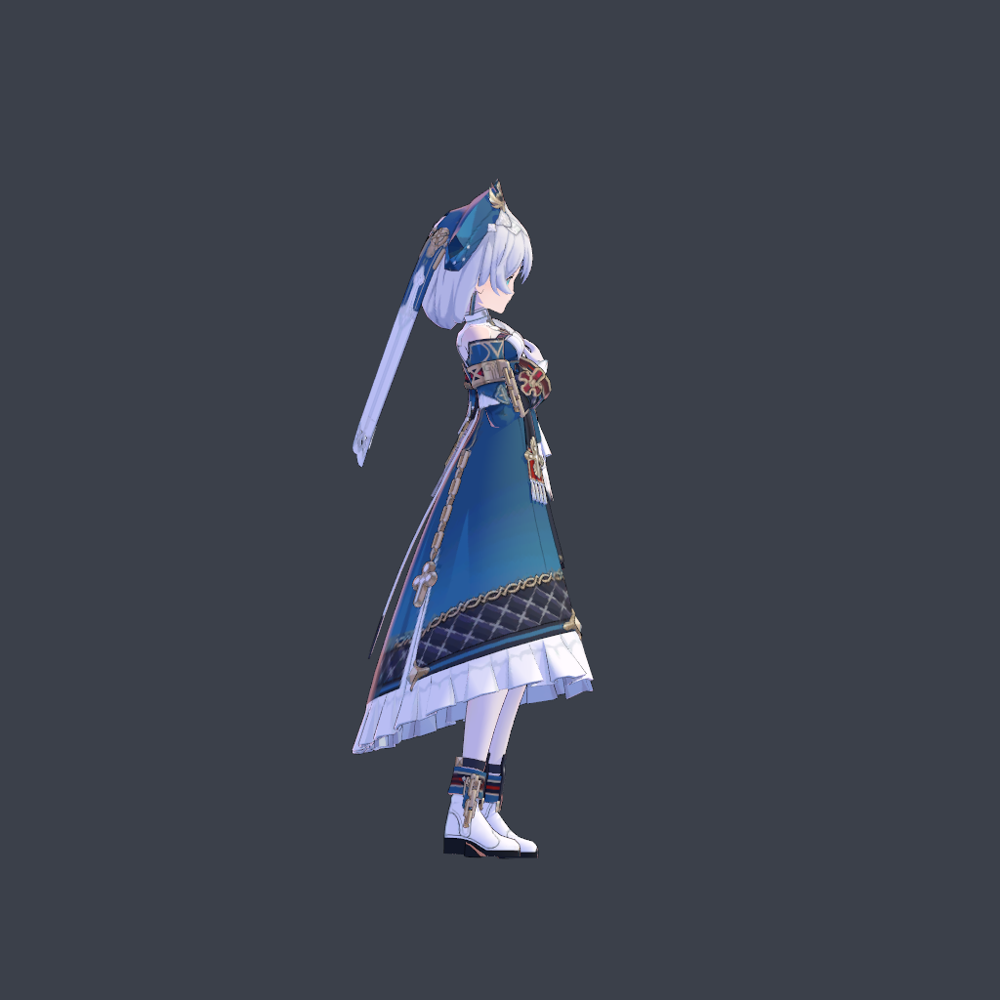
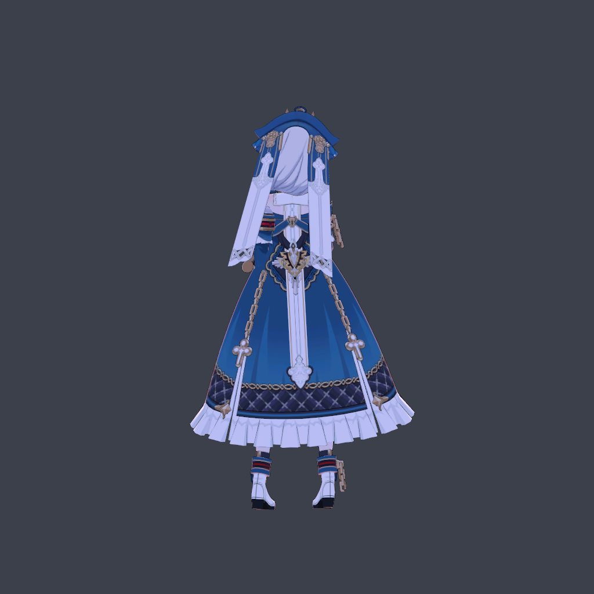
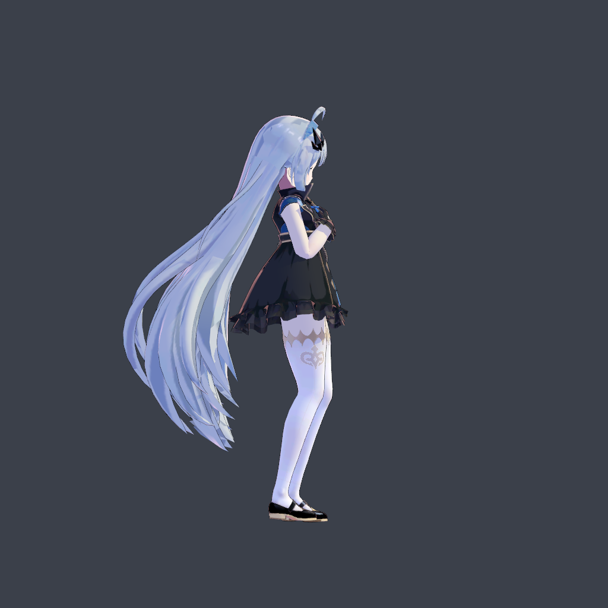
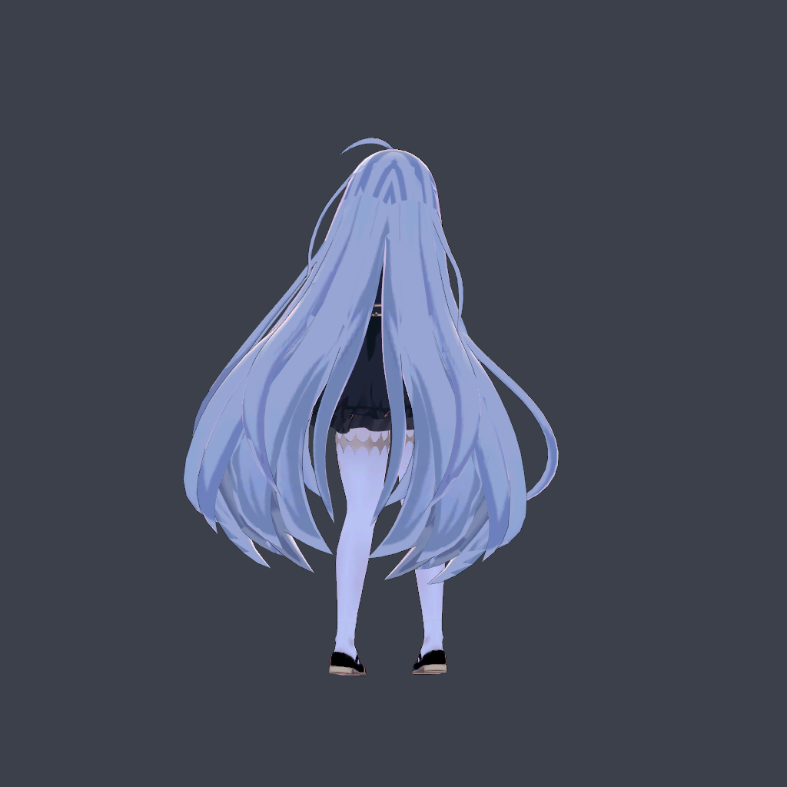
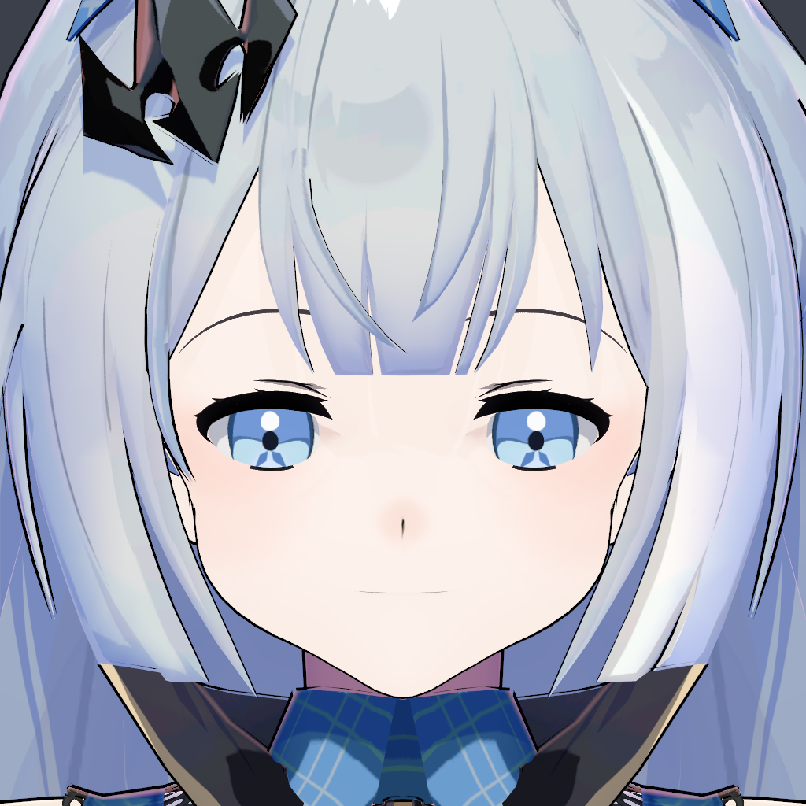
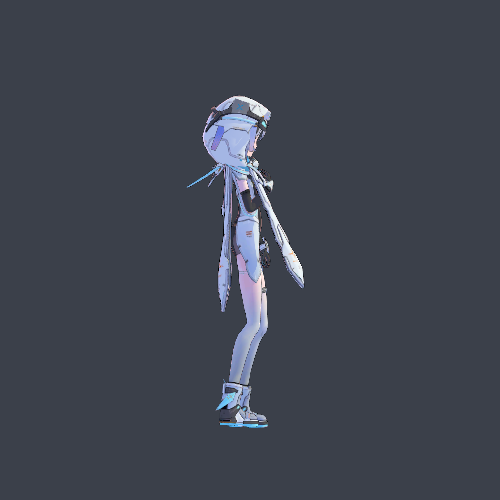
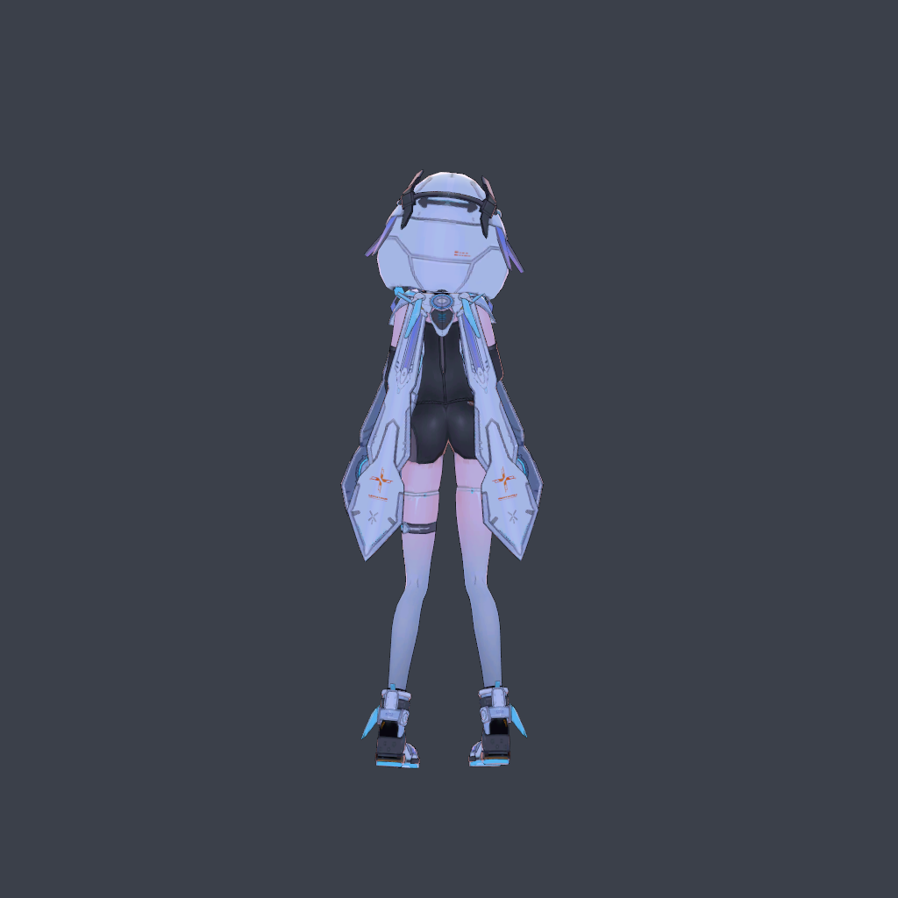

# 三个示例：配置、实际截图与本地复现

每个模型目录包含 `preset.json`；展示截图集中放在 `docs/images/runtime/`。配置包含源文件名、SHA256、材质 ID/名称与分类、参数和骨骼覆盖；没有 PMX、贴图、网格、人物卡或游戏资源。请先通过文末的作者入口获取模型及完整贴图目录，阅读使用规约。

## 复现步骤

1. 完成 [SETUP](../docs/SETUP.md)，提供自己的女性基础卡和 KK OverlayMods。
2. 在 Blender pmx2KK 面板选择源 PMX，导入比例 `0.08`，指定独立工作目录，点击 **检查 PMX**，等待完成。
3. 查看当前 recipe 路径。暂停面板操作，在本仓库/示例包根目录打开 PowerShell，运行以下辅助脚本（替换 Blender 与 recipe 的实际路径）：

```powershell
& 'D:\Apps\Blender 4.5\blender.exe' --background --factory-startup --python-exit-code 1 --python tools/apply_example.py -- --preset examples/theresa/preset.json --recipe 'D:\pmx2kk-work\jobs\p78aec52e5224n21\recipe.json'
```

4. 脚本检查 PMX 内容哈希、检查报告哈希、材质 ID/名称、导入比例和版本，只复制分类、调节参数及骨骼覆盖，保留你的本机路径和资源 ID。修改前生成 `recipe-before-example-*.json`；任何校验不匹配都会在写入前停止。
5. 回到 Blender，点 **检查 PMX 右侧的文件夹图标（恢复转换配置）**，打开刚更新的 `recipe.json`，确保面板重新载入。此时不要再次“检查 PMX”，否则分类会被重新初始化。
6. **载入源模型**，检查部件及骨骼，再手工勾选确认。脚本刻意不替你确认视觉结果。
7. **转换并渲染** → 检查预览 → **生成 zipmod**，按[教程](../docs/USER_GUIDE.md)安装并验收。

如有系统 Python 3.10+，也可以用 `python tools/apply_example.py --preset ... --recipe ...`；不需要额外 pip 包。脚本不能在后台转换正在运行时执行。

哈希不符通常是模型更新、选择了另一个比例版本，或编辑过 PMX。不要禁用检查；按常规流程重新分类。哈希只校验 PMX 内容，不涵盖贴图内容，因此仍须保留原贴图并视觉核对。

## 每个示例的重点

| 配置 | PMX 文件 | 任务目录 | 关键选择 |
|---|---|---|---|
| [theresa](theresa/preset.json) | `主教德丽莎1.0.pmx` | `p78aec52e5224n21` | 脸材质 16；发带/耳环/头带等设为头饰；头发静态 |
| [demon-lord](demon-lord/preset.json) | `女魔王_游戏比例版.pmx` | `p7df4c5d7a70bn21` | 脸材质 1；`女魔王_ex` 跟头；使用游戏比例版；长发保持静态 |
| [leviathan](leviathan/preset.json) | `利维坦.pmx` | `p2b73712c396fn21` | 脸材质 19；材质 8「兜帽」按高度 1.0 分割；启用短刘海模板 |

三者的身体宽度、头发缩放与脸型强度都为 1.0，偏移为零；这是完成自动归一化后的修正倍率，并非源 PMX 共用同一世界尺寸。利维坦的短刘海模板不意味着整条兜帽、长垂饰或裙摆都拥有物理。

源 PMX SHA256：

```text
Theresa:   78aec52e52243ed5e530f486080a78d5838d6121883730cf0b6fcbab194c0097
DemonLord: 7df4c5d7a70b13bff4cbc5be8d9463983db1b43624cbb3a7b8a8a76300abb791
Leviathan: 2b73712c396fd21abdeab78f5e8fa781cb5acfdb6bb4718251aee4fce6f31048
```

其他字段见对应 `preset.json`，辅助脚本直接读取 JSON 校验。所有配置来自已验收的 v0.2.1 本地任务；基础卡、游戏 mod 环境、贴图或模型版本不同可能影响最终外观。

## 实际效果与验收截图

以下 18 张图是 v0.2.1 最终验收中的 KK Studio 实际运行截图，直接复制原 PNG，未修图或重新生成。全身图和表情图来自运行测试，面部特写来自皮肤修复后的检查；不同测试使用的姿态、相机距离不同，不能据此做逐像素前后对比。点击图片可查看原图。

静态图展示外观和指定表情状态；行走、换装、保存重载等功能的测试范围另见[验证记录](../docs/VALIDATION.md)。图片不会替代你的游戏内验收。

### 德丽莎

模型编辑：神帝宇；版权：miHoYo。

| 全身正面 | 全身侧面 | 全身背面 |
|---|---|---|
|  |  |  |

| 面部特写 | 原生闭眼 | 原生张嘴 |
|---|---|---|
|  |  |  |

### 女魔王

模型：星塔旅人/魔王酱酱酱_；版权：悠星网络。

| 全身正面 | 全身侧面 | 全身背面 |
|---|---|---|
|  |  |  |

| 面部特写 | 原生闭眼 | 原生张嘴 |
|---|---|---|
|  |  |  |

### 利维坦

模型编辑：神帝宇；版权：深空之眼。

| 全身正面 | 全身侧面 | 全身背面 |
|---|---|---|
|  |  |  |

| 面部特写 | 原生闭眼 | 原生张嘴 |
|---|---|---|
|  |  |  |

原始截图文件名、尺寸及 SHA256 记录在[截图清单](../docs/images/runtime/manifest.json)。这些 PNG 是普通截图，不附带人物卡数据。

## 模型来源与使用规约

- **德丽莎**：[原模型页](https://www.aplaybox.com/details/model/vanHVdtz5qq6)，模型编辑神帝宇，版权 miHoYo。
- **女魔王**：[作者配布公告](https://www.bilibili.com/video/BV1TuQmBVEon/)，作者魔王酱酱酱_；使用时标注「模型：星塔旅人/魔王酱酱酱_」，版权悠星网络。下载入口以作者公告及置顶说明为准。
- **利维坦**：[神帝宇的作品页](https://www.aplaybox.com/u/359396473/model)，版权深空之眼。独立配布链接尚未确认，请在作者渠道搜索「利维坦」并核对 PMX 哈希；当前是否仍可取得该版本未确认。

三个原包均禁止二次分发和商业用途。德丽莎、利维坦允许改造、骨骼刚体优化和 UV 重制；女魔王允许合理优化，但禁止拆件用于其他模型、冒认作者。三者均限制成人、极端宗教、血腥恐怖猎奇、人身攻击等用途。请阅读原包完整规约。本示例不提供再分发授权；模型、贴图、转换卡与 zipmod 不随源码公开。
